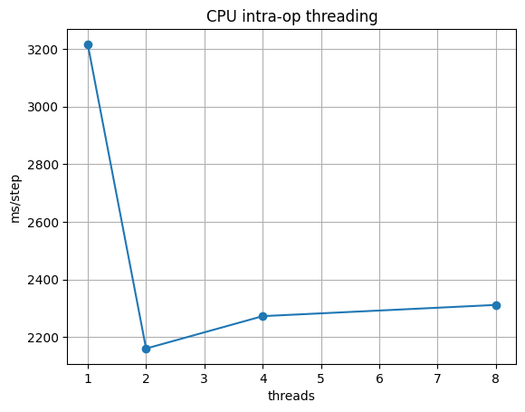

# Phase 2 — Reflection: where does parallelism stop helping?

Mathis Nawrocki-Lachapelle — EURECOM, Cloud Computing, Phase 2 (tiny GPT).
Training done in Google Colab (T4 GPU, 2 vCPUs, Intel Xeon @ 2.00GHz). All numbers are copied from `submission/phase2_report.json`.

---

## 1. Your measurements

| | Value |
|---|---|
| Naive attention, ms (`attention.naive_ms`) | <!--answer:attn_naive_ms-->259.266<!--/answer--> |
| Vectorized attention, ms (`attention.vectorized_ms`) | <!--answer:attn_vectorized_ms-->17.006<!--/answer--> |
| CPU training, ms for 100 steps (`devices.cpu_ms`) | <!--answer:cpu_ms-->472540.7<!--/answer--> |
| GPU training, ms for 100 steps (`devices.gpu_ms`) | <!--answer:gpu_ms-->13713.5<!--/answer--> |
| Final training loss (`training.final_loss`) | <!--answer:final_loss-->1.4978<!--/answer--> |

**The thread sweep.** Give your four timings from `threads` — 1, 2, 4 and 8 threads — and say
which count was fastest. (verbatim: the numbers, in order)

<!--answer:thread_sweep-->
3216.418, 2159.808, 2272.336, 2311.32
Fastest: 2 threads.
<!--/answer-->

---

## 2. Intra-node parallelism, three ways

**Why vectorizing wins.** Both attention implementations do the same arithmetic and produce the
same result (the unit test checks that). Explain where the naive version's time actually goes,
and what the vectorized one does differently — in terms of the machine, not the Python.
(~70 words)

<!--answer:vectorization_why-->
In the naive version, almost all the time is overhead, not maths. The two Python loops do 256 × 256 iterations each, so about 131,000 small steps, and each one calls `np.dot` on two vectors of only 64 numbers. The interpreter and the function calls cost much more than the multiplications themselves. The vectorized version makes one `Q @ K.T` call into OpenBLAS, which runs compiled code with the AVX2/AVX-512 instructions listed by `np.show_config()`: one instruction works on several numbers at once, and the data stays in the cache. My speedup is only 15.25x (not ~100x), I think because the naive code already uses `np.dot` for each dot product.
<!--/answer-->

**Where the thread curve flattens, and why.** Using your sweep: more threads stopped helping —
or started hurting — at some point. Say where, and give the reason. Your Colab runtime's vCPU
count is part of the answer; so is what the threads have to coordinate on. (~80 words)

<!--answer:threading_plateau-->
My Colab runtime has 2 vCPUs (`nproc` printed 2). Going from 1 to 2 threads helped (3216.418 → 2159.808 ms, about 1.49x, not 2x), but 4 and 8 threads were slower (2272.336 and 2311.32 ms). With more threads than vCPUs, the OS has to switch between them, and after each operation (a matrix multiply split in pieces) all threads must wait for the slowest one before going on. The gain at 2 threads is not 2x because some parts of the step stay serial, and I think the 2 vCPUs are two hyperthreads of one physical core (PyTorch chose 1 thread by default), so they share the same compute units.
<!--/answer-->

**What made the GPU faster.** The model, the data and the step count were identical; only the
device changed. Say what about a transformer training step suits a GPU, and name one workload
that would *not* see this speed-up. (~70 words)

<!--answer:gpu_why-->
A training step is mostly big matrix multiplications (32 sequences × 256 tokens × 256 dimensions) in the attention and MLP layers. It is the same simple operation on many independent numbers, so the T4 can run it on thousands of CUDA cores at the same time (SIMT). This gave 472540.7 ms on CPU vs 13713.5 ms on GPU (about 34x). A workload that would not benefit: generating text one token at a time for one user (batch size 1), because each step is tiny and depends on the previous one, so kernel launches and transfers take most of the time.
<!--/answer-->

---

## 3. The question

**Where does parallelism stop helping, and why?** Pull the three experiments together. Your
answer should distinguish the *kinds* of limit you met — work that cannot be divided, hardware
you do not have, coordination that costs more than it saves, data that has to move — and say
which one bound each experiment. One concrete number from section 1 per claim. (~150 words)

<!--answer:parallelism_limit-->
I met four different kinds of limit.

- **Work that cannot be divided.** In the naive attention, the Python loop runs one iteration after the other, so the SIMD units cannot help. Removing this serial overhead is what gave 259.266 → 17.006 ms. The same idea (Amdahl's law) explains why 2 threads gave only 1.49x: part of each step stays serial.
- **Hardware I do not have.** Colab gives only 2 vCPUs, so after 2 threads there is nothing more to run on. The best time was 2159.808 ms, at 2 threads.
- **Coordination that costs more than it saves.** At 8 threads the step took 2311.32 ms, about 7% slower than at 2 threads, because the threads fight for the 2 vCPUs and wait for each other.
- **Data that has to move.** On the GPU, each step copies a batch from the CPU, launches many small kernels and waits for `loss.item()`. The GPU was still about 34x faster (13713.5 vs 472540.7 ms), but this includes the CUDA start-up, and the CPU baseline used only 1 thread: against 2 threads it would be closer to ~23x (rough estimate from my sweep). I did not measure GPU usage, so I can only guess that this small model does not fill the T4.
<!--/answer-->

**What you would measure next.** One experiment this phase did not run that would sharpen the
answer, and what result would change your mind. (~50 words)

<!--answer:next_experiment-->
I would train on the GPU with different batch sizes (8, 32, 128, 512) and watch `nvidia-smi`. If the time per step stays almost the same when the batch grows, the GPU was starved by overhead and data movement. If the time grows with the batch, the GPU was already full, and my explanation about data movement would be wrong.
<!--/answer-->
